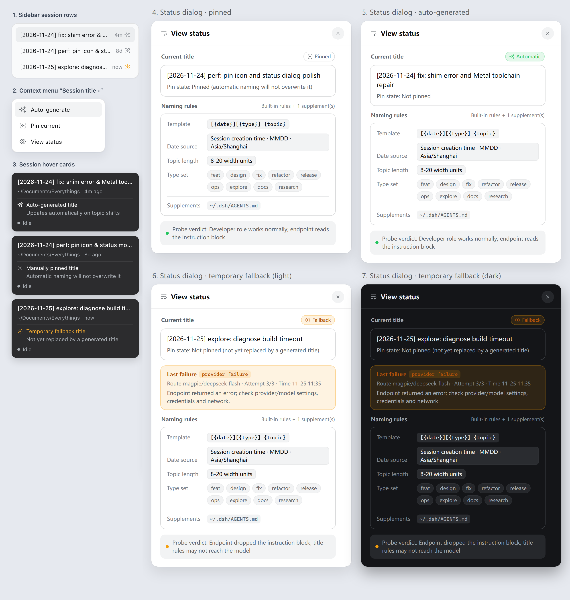

# session-title-template

English | [简体中文](README.zh-CN.md) · [Catalog](../../README.md)

A configurable `[date][type] topic` title provider for [DeepSeek Harness](https://github.com/deepseek-ai/deepseek-harness). Dates come from session creation timestamps; the type vocabulary, template, time zone and prompt language are configurable. Three current-session tools support explicit rename, regeneration and a read-only status view, and a sidebar UI exposes the same operations.

## Install

Requires Node.js 22+. Tested against the installed DSH `0.2.1-rc.3`, `0.2.2-rc.1`, `0.2.2-rc.2` and `0.2.3-alpha.2` services; declared compatibility is `>=0.2.1-rc.3 <0.6.0`.

The package is `@redheartsecretman/session-title-template`, version `0.2.1`. Install the [Release archive](https://github.com/RedHeartSecretMan/dsh-plugins/releases/download/session-title-template-v0.2.1/session-title-template-0.2.1.tgz) through the plugin manager (`install_bundle`) or the CLI:

```sh
dsh plugin --profile <profile> add https://github.com/RedHeartSecretMan/dsh-plugins/releases/download/session-title-template-v0.2.1/session-title-template-0.2.1.tgz
```

To install from a checkout instead:

```sh
git clone https://github.com/RedHeartSecretMan/dsh-plugins.git
dsh plugin --profile <profile> add /absolute/path/to/dsh-plugins/plugins/session-title-template
```

Use `<clone>/plugins/session-title-template` as the plugin manager's target, not the repository root.

The bundle disables the shipped `session-title-llm`. Disable other title providers too: the service accepts one provider. Follow the Host's application outcome; a restart-required result means fully quit and reopen Desktop.

## Configure

Override `id: session-title-template` in your profile's user patch. The whole `config` object is replaced, not recursively merged; omitted fields use plugin defaults. Do not insert another provider merely to change its settings.

| Field | Default | Meaning |
|---|---|---|
| `template` | `[{date}][{type}] {topic}` | Each placeholder exactly once; order and literal separators are configurable |
| `dateFormat` | `MMDD` | Complete `YYYY`, `YY`, `MM`, `DD` tokens and `- / . _` separators; month/day required |
| `timezone` | `Asia/Shanghai` | IANA zone for the creation timestamp |
| `language` | `zh` | `zh` or `en`; selects prompt language, not translated type labels |
| `uiLanguage` | `auto` | Plugin UI language override. `auto` follows DSH, while `zh` and `en` affect this plugin's menus and dialogs only |
| `types` | Nine Chinese types | Array of strings or `{ key, hint, provisional?, maxRefinements? }` objects (`maxRefinements` is an optional per-type 1–100 override requiring `provisional: true`) |
| `fallbackType` | `探索` | Local fallback type when no route is available; must exist in the vocabulary |
| `fallbackTruncation` | `natural` | Model-free fallback topic truncation. `natural` prefers a completed sentence before falling back to a clause boundary, while `hard` stops at the last whole token that fits — it never splits a token, so the result can stay just under the limit |
| `cjkSpacing` | `true` | Space between Han text and adjacent Latin letters/digits |
| `topicMinChars` | `8` | Prompt guidance; a useful short topic is not rejected just to reach this target |
| `topicMaxChars` | `20` | CJK-equivalent width limit for the topic (ASCII = 0.5, spaces = 0), truncated on word/clause boundaries |
| `provider` / `model` | unset | Main-agent title route; supply both or neither, otherwise use the session route |
| `subagentRoute` | unset | Optional `{ provider, model }` route for subagent title generation/refinement; inherits the main route when unset |
| `fallbackRoute` | unset | Optional `{ provider, model }` backup for **every** title request: the route used when no primary route resolves, the retry fallback after a primary failure, and the preferred route for a targeted retitle; independent of `backfill.enabled` |
| `subagentDelegationLabel` | `true` | Use a subagent's `delegationLabel` as the first title without a model call. Set `false` to call the title model on turn one |
| `maxInputBytes` | `4096` | Final framed JSON UTF-8 byte budget, including escaping and wrapper text |
| `maxOutputTokens` | `4096` | Output cap; uses the lowest supported reasoning effort; the cap includes hidden reasoning, while topic length is validated separately |
| `timeoutMs` | `60000` | Deadline for one candidate-route attempt |
| `retryAttempts` | `3` | Total rounds including the first attempt (1–5). Each round walks every configured route in order; rounds back off by `retryDelayMs` |
| `retryDelayMs` | `500` | Backoff base in milliseconds after the first round (0–10000); round n waits `retryDelayMs × 2^(n-1)`, capped at 10 s |
| `roleProbe.enabled` | `true` | Observation-only probe of whether the endpoint actually receives the instruction block; verdicts are logged and never rewrite the profile or switch routes |
| `maxProvisionalRefinements` | `4` | For summarized provisional titles, refine within the first N eligible messages; **not a rewrite counter**. Recognizable fallbacks remain retryable |
| `agentsInstructions.enabled` | `true` | Read applicable AGENTS naming excerpts and add main-agent naming coordination; `false` disables both |
| `agentsInstructions.maxBytes` | `4096` | Final supplemental guidance UTF-8 byte limit; integer from `256` to `65536` |
| `backfill.enabled` | `false` | Run one historical maintenance pass after startup |
| `backfill.retitle` | `[]` | Targets `[{ id, hint }]`, executed only while backfill is enabled |

Unknown keys produce an activation error rather than silently discarding settings.

```yaml
- id: session-title-template
  config:
    template: '[{date}] {type}: {topic}'
    dateFormat: YYYY-MM-DD
    language: en
    cjkSpacing: false
    types:
      - { key: feat, hint: New capability }
      - { key: fix, hint: Bug fixes }
      - { key: explore, hint: Understanding current behaviour, provisional: true }
    fallbackType: explore
```

The settings dialog provides Chinese and English naming presets. A preset updates the default vocabulary, fallback type, prompt language, CJK spacing, and template together, while each field remains editable afterward. The Types table keeps the provisional switch and per-type refinement count beside each vocabulary row. The fallback policy explains that model-free titles use natural sentence, word, and parallel-clause boundaries.

The default Chinese vocabulary is 功能, 设计, 修复, 优化, 发布, 运维, 探索, 文档, 研究. `探索` is provisional. A canonical concrete title with the correct creation date is retained while the adaptive policy sees no reason to evaluate; summarized provisional titles refine when new substantive input arrives. Deterministic first-message fallbacks, including legacy provider-labelled fallbacks and Host-truncated fallbacks without model provenance, remain retryable. Retaining a title preserves its model provenance. Model output is leniently normalized, but stored titles require canonical syntax and the correct date, so malformed legacy dates are not frozen as settled.

## Automatic refresh

The provider follows the conversation automatically, but does not spend one model call per prompt. A cheap local policy decides whether a title evaluation is worthwhile:

- Always evaluate: explicit refresh/targeted retitle, a fallback/recovery title, a non-canonical title, the first provider title, or a provisional title still inside its `maxProvisionalRefinements` window with new substantive input.
- Evaluate on explicit topic-shift phrases, a substantive message with low lexical overlap against the current title and recent messages, and a periodic audit after six human messages or roughly 1,500 new UTF-8 bytes.
- Skip short acknowledgements and continuation messages; the same evaluated messages are not evaluated again.

When the model is called, the current title travels as a JSON anchor with explicit stability rules: a still-accurate title must be returned exactly unchanged, and only a materially changed main task justifies a rewrite. Returning the same title preserves its original provenance instead of creating a rewrite. The template, creation date, type vocabulary, length limits and explicit tools remain unchanged.

## AGENTS naming guidance

The plugin remains the automatic naming owner. When a title needs generation or provisional refinement, it reads applicable `AGENTS.md` naming excerpts. Discovery is implemented inside the plugin over the global homes and the `.git` root-to-working-directory chain, with realpath deduplication.

A heading matches when it combines 会话 or 对话 with 命名 or 标题, or session or conversation with naming or title. Matching is case-insensitive for English, and headings inside fenced code blocks are ignored. For an explicit excerpt, put the intended naming guidance between these markers:

```markdown
<!-- session-title-template:start -->
Prefer a concise topic describing the user's current task.
<!-- session-title-template:end -->
```

Only matching naming excerpts enter the supplemental prompt; unrelated engineering instructions are left out. `agentsInstructions.maxBytes` bounds the final supplemental UTF-8 text, with more-specific excerpts retained preferentially. Source reads are bounded and discovery has a soft timeout. Missing rules, discovery/read failures or the timeout preserve existing naming behavior and emit a bounded diagnostic category. Files are reread when generation needs them, with no filesystem cache or continuous watcher. Changing a file alone does not regenerate an existing canonical settled provider title.

AGENTS guidance may influence topic wording and provisional refinement. The configured template, creation date, type vocabulary, topic length limits and user-title pin remain authoritative. A `systemPrompt` coordination section asks the main agent to leave automatic naming to the plugin when only standing AGENTS rules request a rename; an explicit user rename should call `rename_current_session` rather than hand the task back to the GUI. This section is guidance, not a rename API restriction, and deployments that replace the complete system prompt may omit it. Set `agentsInstructions.enabled: false` to disable both the supplemental excerpts and coordination. The plugin never edits AGENTS files.

## Model errors and ownership

The provider handles `text-delta`, completed `block-end` text and terminal `finish` events. Only a normal `stop` result can be accepted. Error, cancellation, truncation and tool-call partial output never become titles. Failed calls or parsing try every configured route in one round, then retry the route set with bounded exponential backoff before Harness retains the current title or its built-in fallback. With no available route, a local title can be derived from the first message.

Harness suppresses automatic updates to user-pinned titles. An **explicit UI refresh** intentionally unpins them. Backfill always skips user titles, even a configured retitle target. Auxiliary calls use the built-in `session/title-llm-request` record; diagnostic files contain only route, attempt, provider code and a bounded local failure category, never title, prompt, response or raw error text.

## Sidebar UI and `/title` command



The package includes a Web UI client half (`client.js`) and an in-session `/title` slash command:

- **Row indicators & hover card**: Each session row displays a star-family icon derived from the `sessionTitleState` projection — free sparkle (`provider` automatic), corner-framed star (`user` manually pinned, distinct from Pin Session's pushpin), or dashed-ring star (`fallback` temporary title) — paired with a matching hover-card status section.
- **`Session title ›` context submenu** (works on cold sessions for status and settings; Auto-generate needs an open session):
  - **Auto-generate**: Forces regeneration (and unpins a manual title) on an open session through an owner-only `POST /session-title-template/refresh` route (falling back to `/title refresh` before a Host reload), showing in-flight progress without appending command blocks into the conversation.
  - **Pin current**: Pins the current title via `SessionFace.rename` (`ctx.sessions.using`), resuming a cold session when needed; disabled when the title is already pinned or absent.
  - **View status**: Opens a localized `shell.overlay` modal showing the current title and badge, any unresolved failure with advice, built-in rules, contributing `AGENTS.md` supplements, and the role-probe verdict. Reads through an owner-only `GET /session-title-template/status` route for both live and persisted cold sessions without opening an agent or mutating the session log.
  - **Naming settings**: Opens a four-tab modal (**Format** with live title preview, `template`, `language`, topic length, CJK spacing, `dateFormat`, and `timezone`; **Types** with decoupled **Policy** (`fallbackType` plus per-type provisional refinement counts) and collapsible **Vocabulary** (`types` keys/hints and restore-defaults); **Models** with a unified **Title generation** card for main-agent, subagent (`subagentRoute`), and fallback (`fallbackRoute`) routes backed by `ctx.llm` plus manual entry; **Behavior** with **General** toggles and `agentsInstructions.maxBytes`, plus collapsible **Advanced** parameters for input/output budgets, timeout, and retries).
- **Plugin detail page YAML editor** (`plugins.bundle.config`): In DSH's Plugins manager detail page for this package, developers can view and directly edit the plugin's complete `config` block as YAML (including `backfill.retitle`), expand all defaults, validate syntax and schema before saving, or reset to bundle defaults. Both settings surfaces read and persist through the owner-only `GET`/`POST /session-title-template/settings` route backed by the Harness config editor, keeping comments, other plugins' rows, and `!!js` expressions in the profile patch intact. Saving reloads this plugin (cancelling in-flight title requests); unchanged saves never write, and read-only profiles or overridden values are surfaced explicitly.
- **`/title` command**: Inside any live conversation, run `/title` (or `/title status`), `/title refresh`, `/title pin <title>`, or `/title auto`.

## Explicit current-session tools

When the Host tools service is available, the plugin registers three tools globally across agent presets: `rename_current_session`, `refresh_current_session_title` and the read-only `describe_current_session_title`. Disabling AGENTS guidance does not remove them. All three keep the default exclusive scheduling and normal Harness execution policy. With `backfill.enabled`, a fourth tool `backfill_session_titles` previews historical repairs and applies only the ids a person approved.

- `rename_current_session({ title })` calls the official title service, cancels in-flight generation and pins the accepted title.
- `refresh_current_session_title({})` explicitly bypasses automatic stability and regenerates through `sessionTitle.refresh()`, deliberately unpinning a user title.
- `describe_current_session_title({})` is read-only: it reports the built-in rules, the number and list of contributing supplements, the current title source and pin state, the newest failure category and the role-probe verdict.

Targets come only from `execution.agent.session`; no session id is accepted. Missing/stale agents and extra fields are rejected. Both write tools require flush and read-back; the read-only status tool writes nothing. If persistence fails, the error explains that memory may already have changed; retrying the same pinned title avoids duplicate rename events.

The tested Harness provider request carries no automatic/explicit trigger. The plugin does not guess from event order or words in user messages. **Use `Session title › Auto-generate`, `/title refresh`, or `refresh_current_session_title` for a forced regeneration**: native GUI refresh can still retain an already summarized title under the automatic stability policy. Initial/fallback recovery is unaffected. A future SDK trigger discriminator can enable direct GUI-refresh support.

Follow the Host reload outcome after upgrading; restart when required. Installing or editing the package does not prove an existing session has the new tools.

## Backfill and state

Backfill is off by default. When enabled, it starts once after 2.5 seconds. `sessionQuery.readSession` performs read-only eligibility checks before resuming anything. It skips subagents, pinned titles, canonical titles, interrupted historical turns and currently running agents. Targeted retitles can rewrite canonical provider titles, once per exact id/hint.

A candidate's title must be accepted and acknowledged by `sessions.flush()` before completion is recorded. Failures remain retryable. Only handles created by the pass are disposed. Plugin unload cancels its timer and aborts/drains running maintenance; ordinary prompts never repeatedly force a configured retitle hint.

With `DSH_PROFILE_DIR` set:

```text
$DSH_PROFILE_DIR/state/session-title-template/backfill-state.json
$DSH_PROFILE_DIR/state/session-title-template/backfill.log
$DSH_PROFILE_DIR/state/session-title-template/diagnostics.jsonl
```

Otherwise use `$DSH_HOME/profiles/$DSH_PROFILE/state/session-title-template/`, or the legacy `$DSH_HOME/session-title-template/` only when there is no profile. `DSH_HOME` defaults to `~/.dsh`.

`diagnostics.jsonl` holds structured diagnostics (title failures, probe verdicts) with per-field truncation and a bounded record count. Exclusive locks, atomic replacement and recoverable queues protect bookkeeping across activations/processes. Corrupt state is surfaced and preserved. Lock waits are bounded; locks are never stolen. After an abnormal process exit, remove a leftover `.lock` only after confirming that no writer is active. Diagnostic logs rotate at 512 KiB with one bounded backup; logging failures do not change title/bookkeeping success.

## Development

No dependencies to install or build step. The optional AGENTS feature uses the plugin's self-contained discovery path:

```sh
cd plugins/session-title-template
npm test
npm run check
```

Tests use isolated temporary directories, including AGENTS discovery/extraction and byte limits, config validation, naming coordination, multi-process state updates, flush failure, read-only backfill preflight and unload cancellation. `scripts/verify-runtime.mjs <runtime-root>` additionally checks the installed SessionStore, projections, title service and Cordis lifecycle; ASAR installs require Electron's Node carrier. It uses the real profile linked-package resolver, tool registry and title service. The LLM and disk durability listener are fixtures: this does not test external model availability or production-writer restart recovery. For a real-model smoke test, `test/verify-gateway.mjs` is opt-in via `RUN_SESSION_TITLE_LIVE=1` and a gateway/model:

```sh
RUN_SESSION_TITLE_LIVE=1 SESSION_TITLE_GATEWAY=http://127.0.0.1:3425/v1 SESSION_TITLE_MODEL=auto/deepseek-flash MAGPIE_GATEWAY_KEY=... \
ELECTRON_RUN_AS_NODE=1 '/Applications/DeepSeek Harness.app/Contents/MacOS/DeepSeek Harness' test/verify-gateway.mjs
```

See [validation and behavior boundaries](docs/VALIDATION.md) for checked contracts and limits.

## License

[MIT](LICENSE)
