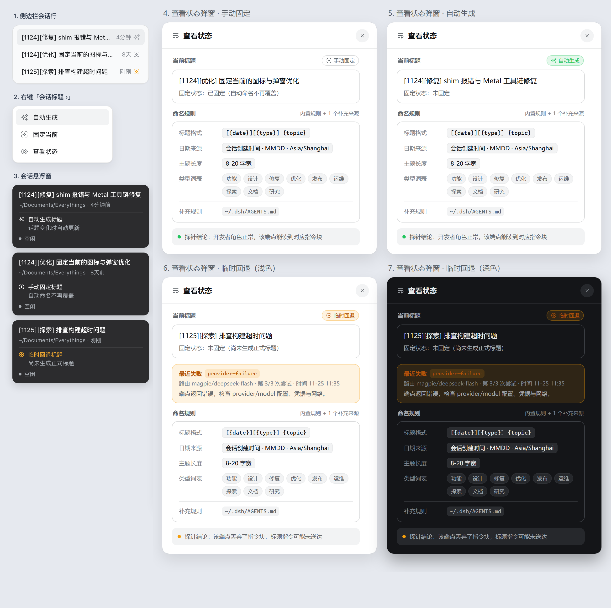

# session-title-template

[English](README.md) | 简体中文 · [插件目录](../../README.zh-CN.md)

为 [DeepSeek Harness](https://github.com/deepseek-ai/deepseek-harness) 生成 `[日期][类型] 主题` 格式的标题。日期取自会话创建时间；类型、模板、时区和提示词语言都可配置。提供三个针对当前会话的工具（改名、重新生成、状态查询）、`/title` 命令以及侧栏 UI 状态展示与快捷操作。

```text
[1025][修复] 排查登录超时
[1025][功能] 新增导出 PDF 能力
[1025][探索] 了解网关设置含义
```

## 安装和兼容性

需要 Node.js 22 或更新版本；在 DSH `0.2.1-rc.3`、`0.2.2-rc.1`、`0.2.2-rc.2` 与 `0.2.3-alpha.2` 的真实 SessionStore、标题服务和 Cordis 生命周期上验证过。声明支持 `>=0.2.1-rc.3 <0.6.0`，不对更高版本的内部接口作保证。

包名为 `@redheartsecretman/session-title-template`，当前版本为 `0.2.1`。在插件管理中通过 `install_bundle` 安装 [Release 压缩包](https://github.com/RedHeartSecretMan/dsh-plugins/releases/download/session-title-template-v0.2.1/session-title-template-0.2.1.tgz)，或使用 CLI：

```sh
dsh plugin --profile <profile> add https://github.com/RedHeartSecretMan/dsh-plugins/releases/download/session-title-template-v0.2.1/session-title-template-0.2.1.tgz
```

也可以从仓库目录安装：

```sh
git clone https://github.com/RedHeartSecretMan/dsh-plugins.git
dsh plugin --profile <profile> add /absolute/path/to/dsh-plugins/plugins/session-title-template
```

插件管理的安装目标为 `<clone>/plugins/session-title-template`，不要选择仓库根目录。

安装会禁用内置 `session-title-llm`。标题服务同时只接受一个提供方；其他第三方标题提供方也应先停用。是否热生效取决于 Host 的重载能力，安装结果要求重启时请完整退出并重新打开桌面版。

## 配置

通过 profile 的用户补丁覆盖 `id: session-title-template` 的 `config`。**用户补丁中的 `config` 是整块替换，不是递归合并**；未提供字段使用下表默认值。不要为覆盖配置再插入一个同名 provider。

| 字段 | 默认值 | 含义 |
|---|---|---|
| `template` | `[{date}][{type}] {topic}` | 三个占位符必须各出现一次，可调整顺序和字面分隔符 |
| `dateFormat` | `MMDD` | `YYYY`、`YY`、`MM`、`DD`；支持 `- / . _` 分隔符，必须有月、日 |
| `timezone` | `Asia/Shanghai` | 按创建时间计算日期的 IANA 时区 |
| `language` | `zh` | `zh` 或 `en`，只选择提示词语言，不自动翻译词表 |
| `uiLanguage` | `auto` | 插件界面语言。`auto` 跟随 DSH，`zh` 和 `en` 只改变本插件菜单、弹窗与状态页 |
| `types` | 9 类中文词表 | 字符串，或 `{ key, hint, provisional?, maxRefinements? }` 对象数组（`maxRefinements` 为可选的按类型 1–100 细化窗口覆盖，须配合 `provisional: true`） |
| `fallbackType` | `探索` | 无可用路由时的本地回退类型，必须在词表内 |
| `fallbackTruncation` | `natural` | 无模型回退主题的截断模式。`natural` 优先停在完整句末，其次回退到分句边界；`hard` 停在最后一个装得下的完整词元，它不切开词元，因此结果可能略短于上限 |
| `cjkSpacing` | `true` | 中文与相邻英文字母、数字之间补空格 |
| `topicMinChars` | `8` | 提示词目标下限；不为凑长度拒绝简短有效主题 |
| `topicMaxChars` | `20` | 按中文等效字宽（ASCII 计 0.5、空格计 0）及分词/分句边界安全截断主题 |
| `provider` / `model` | 未设置 | 主代理标题生成路由；必须同时填写，否则跟随会话路由 |
| `subagentRoute` | 未设置 | 可选 `{ provider, model }`，子智能体生成或细化标题时使用；未设置时跟随主代理 |
| `fallbackRoute` | 未设置 | 可选 `{ provider, model }`。**所有**标题请求的兜底路由（主路由缺失时兜底、主路由失败时重试备用、定点重命名优先使用）；不受 `backfill.enabled` 影响 |
| `subagentDelegationLabel` | `true` | 子智能体首轮有 `delegationLabel` 时直接使用它生成标题。设为 `false` 后首轮直接调用标题模型 |
| `maxInputBytes` | `4096` | **最终 JSON 框架文本**的 UTF-8 字节上限，含转义和包装 |
| `maxOutputTokens` | `4096` | 请求输出上限；选择模型支持的最低推理档位；上限包含隐藏推理词元，标题字数另行校验 |
| `timeoutMs` | `60000` | 每个候选路由的一次请求时限 |
| `retryAttempts` | `3` | 包含首次尝试在内的总轮数（1 至 5）。每轮按顺序试遍所有已配置路由，轮与轮之间按 `retryDelayMs` 指数退避 |
| `retryDelayMs` | `500` | 首轮之后的退避基准毫秒数（0 至 10000），第 n 轮等待 `retryDelayMs × 2^(n-1)`，上限 10 秒 |
| `roleProbe.enabled` | `true` | 只读探测：确认该端点能否真正收到指令块，结果只写诊断日志，从不改写 profile 或切换路由 |
| `maxProvisionalRefinements` | `4` | 已总结暂定标题仅在前 N 条合格消息内细化，**不是改写次数计数器**；可识别回退始终可重试 |
| `agentsInstructions.enabled` | `true` | 读取适用的 AGENTS 命名片段并添加主代理命名协调；`false` 同时关闭两者 |
| `agentsInstructions.maxBytes` | `4096` | 最终补充指导文本的 UTF-8 字节上限，必须是 `256` 至 `65536` 的整数 |
| `backfill.enabled` | `false` | 启动后执行一次历史维护 |
| `backfill.retitle` | `[]` | 定点重命名列表 `[{ id, hint }]`，仅在启用回填时执行 |

未知字段会直接报错，不再静默忽略。

### 英文方案

```yaml
- id: session-title-template
  config:
    template: '[{date}] {type}: {topic}'
    dateFormat: YYYY-MM-DD
    language: en
    cjkSpacing: false
    types:
      - { key: feat, hint: New capability }
      - { key: fix, hint: Bug fixes }
      - { key: explore, hint: Understanding current behaviour, provisional: true }
    fallbackType: explore
```

设置弹窗提供中文和 English 两套命名预设。预设会同时更新默认词表、兜底类型、提示词语言、中英间距和模板，之后仍可逐项调整。「类型」表格把临时开关和每类细化次数放在词表同一行。兜底策略会说明无模型时按句末、分词和并列分句边界自然截断。

默认词表为功能、设计、修复、优化、发布、运维、探索、文档、研究。`探索` 带 `provisional: true`。已有**日期正确、格式规范**的具体类型标题会保留；已经总结过的暂定标题在消息数上限内继续细化。本地首句截断回退（含旧版本标记为 provider 的回退，以及被 Host 字节上限再截断且没有模型来源的回退）不受该窗口限制，路由恢复后继续尝试。保留标题时也保留已有模型来源。模型输出可宽容解析全角括号、缺日期和 Markdown 包裹，但已有标题使用严格校验，错误日期不会被当作“已定稿”。

## 自动刷新

插件会自动跟随对话，但不会每条消息都调用模型。本地轻量策略先判断是否值得评估：

- 始终评估：显式刷新/定点重命名、fallback/recovery 标题、非规范标题、首个 provider 标题，以及仍在 `maxProvisionalRefinements` 窗口内、出现新实质消息的 provisional 标题。
- 触发评估：明确换题短语；与当前标题和近期消息词面重合度低的实质新消息；每 6 条人类消息或约 1,500 个新增 UTF-8 字节的周期审计。
- 跳过短确认/继续消息；同一批已评估消息不重复评估。

真正调用模型时，当前标题以 JSON anchor 传入，并附带明确稳定性规则：仍准确的标题必须原样返回，只有主任务实质变化才改写。模型返回同标题时保留原 provenance，不产生无意义的新标题事件。模板、创建日期、类型词表、长度限制和显式工具保持不变。

## AGENTS 命名指导

插件继续负责自动命名。在需要生成标题或细化暂定标题时，读取适用的 `AGENTS.md` 命名片段。发现逻辑由插件自己实现，范围包括全局目录以及从 `.git` 根目录到当前工作目录的链路，并按 realpath 去重。

Markdown 段落标题需同时包含“会话”或“对话”与“命名”或“标题”，或同时包含 session 或 conversation 与 naming 或 title，才会提取对应片段。英文匹配不区分大小写，忽略围栏代码块中的标题。也可用以下标记明确指定命名片段：

```markdown
<!-- session-title-template:start -->
优先用简短主题概括用户当前的任务。
<!-- session-title-template:end -->
```

只把命中的命名片段加入补充提示，不注入无关的工程指令。`agentsInstructions.maxBytes` 限制最终补充文本的 UTF-8 字节数，优先保留作用域更具体的片段。源文件读取有大小上限，发现流程设软超时；没有命中规则、发现或读取失败以及超时，均沿用现有命名行为，并记一条有界诊断类别。仅在需要生成时重新读取，不缓存文件内容，也不持续监听。修改文件本身不会触发现有规范定稿 provider 标题重新生成。

AGENTS 规则可以影响主题措辞和暂定标题细化，但不能覆盖配置的模板、创建日期、类型词表、主题长度限制或手动标题固定状态。新增的 `systemPrompt` 协调段要求主代理在只有常驻 AGENTS 规则要求改名时，把自动命名交给插件；用户明确要求改名时调用 `rename_current_session`，不要把任务交回 GUI。这段内容是指导，不会阻断重命名 API；完全替换系统提示词的部署可能不包含该段。设置 `agentsInstructions.enabled: false` 会同时关闭补充片段和协调段。插件不会修改 AGENTS 文件。

## 模型失败和标题归属

处理 DSH 的 `text-delta`、`block-end` 和终止 `finish` 事件。只有正常 `stop` 结果可以采纳；错误、取消、词元截断和工具调用中的部分文本不会成为标题。调用或解析失败时先在同一轮里试下一个备用路由，全部失败后按 `retryAttempts` 退避重试整组路由；仍失败则由 DSH 保留现有标题或其内置回退。输入预算不足属于确定性失败，不重试。诊断日志记 `title-call-failed route=<provider>/<model> attempt=<n>/<总数> <错误码>: <失败类别>`，不写入原始错误文本。没有模型路由时可以从首条消息生成本地回退。

DSH 会阻止普通自动请求覆盖手动标题。界面的**显式刷新**有意解除这个固定状态。历史回填即使指定了 `retitle` 也跳过手动标题。辅助模型请求记录到 DSH 内置的 `session/title-llm-request` 事件；诊断日志只记录路由、尝试轮次、provider 错误码和有界的本地失败类别，不写入标题、提示词、响应或原始错误文本。

## 侧栏 UI 与 `/title` 命令



本包同时交付 Web Client 半边（`client.js`）与会话内 `/title` 命令：

- **行尾图标与悬停卡片**：基于 Host 注册的 `sessionTitleState` 投影，在会话行尾与悬停卡片中统一以星芒图标家族展示三种状态——自由星芒（自动生成）、四角框定星芒（手动固定，区别于置顶会话的图钉）、虚线圈星芒（临时回退）。
- **「会话标题 ›」右键子菜单**：
  - **自动生成**：对已打开会话强制重新生成并解除手动固定；优先走 owner 鉴权的 `POST /session-title-template/refresh` 路由（Host 未重载前自动回落到 `/title refresh`），带进行中提示与防重入，不向对话记录追加命令块。
  - **固定当前**：通过 `ctx.sessions.using(..., ref => ref.binding.session.rename(...))` 固定当前标题，冷会话也会自动恢复并落盘；标题已固定或尚无标题时自动禁用。
  - **查看状态**：打开与当前界面语言一致的 `shell.overlay` 模态框，展示当前标题与状态徽章、未恢复的最近失败与建议、内置规则、`AGENTS.md` 补充来源清单及探针结论；通过 owner 鉴权的只读 `GET /session-title-template/status` 路由同时支持活会话与冷会话，不恢复冷会话 Agent，也不修改会话日志。
  - **命名设置**：打开 4-Tab 图形配置弹窗——**格式**（实时标题预览，下分「标题」与「日期」两张卡片，覆盖 `template`、标题语言、主题长度、中英间距、形式与时区）、**类型**（下分「策略」与可折叠「词表」两张卡片：策略中独立维护 `fallbackType` 及可增删的临时类型与各自细化次数，词表专注维护类型名称、分类说明与恢复默认词表）、**模型**（合并为「标题生成」单卡片，基于 `ctx.llm` 自动发现的下拉菜单 + 手动输入入口，依次配置主代理、子代理 `subagentRoute` 与兜底 `fallbackRoute`）、**行为**（下分「常规参数」与可折叠「高级参数」，涵盖 AGENTS.md 补充规则开关与读取上限、端点探针、历史补全及 `maxInputBytes` / `maxOutputTokens` / `timeoutMs` / `retryAttempts` / `retryDelayMs`）。
- **插件详情页 YAML 编辑器**（`plugins.bundle.config`）：在 DSH「插件管理」中点开「会话标题模板」详情页，即可面向开发者直接编辑本插件完整的 `config` YAML（含 `backfill.retitle`），支持一键展开完整默认配置、保存前校验 YAML 语法与配置 schema、一键恢复默认配置。两处设置入口均通过 owner 鉴权的 `GET`/`POST /session-title-template/settings` 路由经 Harness 配置编辑器原子写盘，保留 profile patch 中的注释、其他插件配置与 `!!js` 表达式；保存仅重载本插件（取消进行中的标题请求），未改动时不写盘，只读 profile 或被上层覆盖的配置会明确提示。
- **`/title` 命令**：在任意活会话中可直接输入 `/title`（或 `/title status`）、`/title refresh`、`/title pin <标题>`、`/title auto`。

## 明确改名与重新生成

Host 在工具服务可用时向所有 agent preset 注册三个默认排他执行的工具（`rename_current_session`、`refresh_current_session_title`、只读的 `describe_current_session_title`）；关闭 `agentsInstructions` 不会关闭工具。开启 `backfill.enabled` 时另加 `backfill_session_titles`，它默认只预览：

| 工具 | 参数 | 行为 |
|---|---|---|
| `rename_current_session` | `title` | 调用正式 `sessionTitle.rename()`，取消在飞自动生成并固定标题 |
| `refresh_current_session_title` | 无 | 明确绕过自动稳定性保护，调用正式 `sessionTitle.refresh()` 重新生成；有意解除手动固定 |
| `describe_current_session_title` | 无 | 只读：返回内置规则、补充来源数量与清单、当前标题来源与固定状态、最近失败类别、探针结论 |

目标只从 `execution.agent.session` 取得，不接受会话 id；拒绝无 agent、非 live session 和多余字段。两个写工具（rename 与 refresh）在 flush 成功并读回核对后报告已保存；只读的 `describe_current_session_title` 不写盘。落盘失败会明确说明内存可能已改变；同一个已固定标题的改名重试不重复写事件。工具走 Harness 正常执行策略，不声明只读或绕过权限。

当前已验证的 Harness provider 请求不包含自动/手动刷新原因，所以不根据事件序号或用户文字猜测意图。**需要强制重新生成时使用「会话标题 › 自动生成」、`/title refresh` 或 `refresh_current_session_title`**；内置 GUI refresh 仍可能被已总结标题的自动稳定性保护保留。首次/回退标题恢复不受此限制。后续 SDK 若提供明确触发原因，应再接入内置刷新。

升级后按 Host 的重载结果生效；现有进程要求重启时完整退出再打开。修改代码或安装包本身不代表当前会话工具列表已更新。

## 历史维护和状态

回填默认关闭。启用后延迟 2.5 秒运行一次；先通过 `sessionQuery.readSession` 只读检查，再处理候选会话：

- 跳过子代理、手动标题、已规范标题和尚未闭合的历史轮次；
- 跳过当前正在运行的 agent；定点重命名允许重写已规范的 provider 标题；
- 仅为候选历史会话恢复 agent，结束后释放自己创建的句柄；
- 成功接受标题且 `sessions.flush()` 确认持久化后，才记完成标记；失败可重试；
- `retitle` 按会话 id 和完全相同的 hint 去重，不会借普通消息反复执行；
- 禁用、卸载或重载插件会清理定时器，中止并等待维护任务退出。

有 `DSH_PROFILE_DIR` 时，状态位于：

```text
$DSH_PROFILE_DIR/state/session-title-template/backfill-state.json
$DSH_PROFILE_DIR/state/session-title-template/backfill.log
$DSH_PROFILE_DIR/state/session-title-template/diagnostics.jsonl
```

没有该变量时使用 `$DSH_HOME/profiles/$DSH_PROFILE/state/session-title-template/`；连 profile 也未指定时才使用旧的 `$DSH_HOME/session-title-template/`。`DSH_HOME` 默认 `~/.dsh`。

`diagnostics.jsonl` 保存结构化诊断记录（标题失败、探针结论），按字段截断并有条数上限。状态文件采用独占锁、原子替换和可恢复写队列；损坏的状态不会被当作空进度覆盖。锁等待有界且不偷锁；进程异常退出留下 `.lock` 时，应确认没有活动写入者后再清理。日志保留最多 512 KiB 和一份同上限备份；日志失败不影响记账。

## 开发和验证

无须安装依赖、无构建步骤；可选 AGENTS 功能使用插件自带的文件发现逻辑：

```sh
cd plugins/session-title-template
npm test
npm run check
```

测试全部使用临时目录，包括 AGENTS 发现、片段提取与字节限制、配置校验、命名协调、两个进程并发写入、失败落盘后重试、只读回填预检和卸载取消。`scripts/verify-runtime.mjs <runtime-root>` 可进一步接入已安装的真实 DSH 服务；ASAR 安装需通过 Electron 的 Node carrier 执行。它通过真实 profile linked-package resolver、工具注册器和标题服务验证发现/刷新/改名；LLM 和磁盘 durability listener 是 fixture，不等同于外部模型可用性或完整生产 writer 的重启恢复测试；真实模型冒烟测试使用可选的 `test/verify-gateway.mjs`（`RUN_SESSION_TITLE_LIVE=1` 加网关/模型）：

```sh
RUN_SESSION_TITLE_LIVE=1 SESSION_TITLE_GATEWAY=http://127.0.0.1:3425/v1 SESSION_TITLE_MODEL=auto/deepseek-flash MAGPIE_GATEWAY_KEY=... \
ELECTRON_RUN_AS_NODE=1 '/Applications/DeepSeek Harness.app/Contents/MacOS/DeepSeek Harness' test/verify-gateway.mjs
```

[验证范围与行为边界](docs/VALIDATION.md)说明已核对的契约及使用限制。

## 许可证

[MIT](LICENSE)
